# Лабораторная работа №2 — Node-RED

**Предмет:** «Технологии визуального программирования»  
**Студент:** Sandrakula

**Цель работы:** освоить запуск Node-RED в Docker, создание и соединение нод, обработку сообщений, работу с HTTP API, MQTT, Dashboard, Telegram, файлами и контекстом.

**Технологии:** Node-RED 5.0.8, Node.js 24.21.0, Docker, JavaScript, MQTT, HTTP API, node-red-dashboard, Telegram Bot API.

## Навигация

- [Часть 1. Установка и запуск Node-RED](#часть-1-установка-и-запуск-node-red)
- [Часть 2. Выполнение заданий 2.1–2.12](#часть-2-выполнение-заданий-21–212)
- [Часть 3. Ачивки](#часть-3-ачивки)
- [Часть 4. Вывод](#часть-4-вывод)

## Часть 1. Установка и запуск Node-RED

Node-RED установлен через Docker Desktop и запускается на `http://localhost:1880`. Каталог `lab2/node-red-data` подключён к `/data` контейнера как постоянный bind mount, поэтому потоки и созданные файлы сохраняются после перезапуска. Используются Node-RED **5.0.8** и Node.js **24.21.0**; первый поток успешно отправляет сообщения в Debug каждые пять секунд.

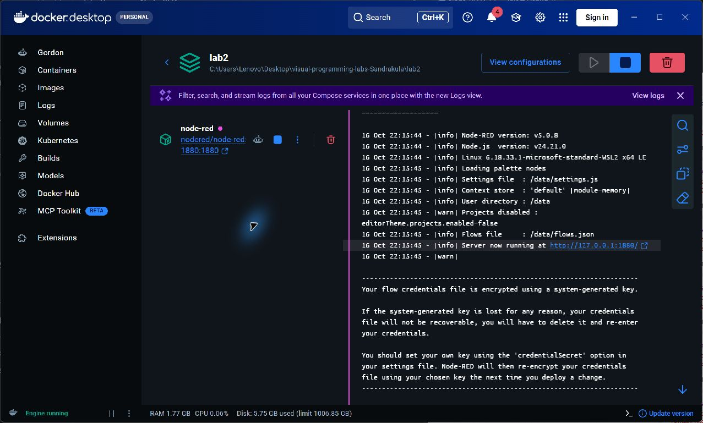

## Часть 2. Выполнение заданий 2.1–2.12

#### 2.1. Inject → Debug

**Что сделали:** Собрали поток `Inject → Debug`. Inject отправляет фамилию `Sandrakula` и topic `lab2/Sandrakula/basic` каждые пять секунд, а Debug показывает полный объект `msg`.

**Результат:** В Debug последовательно появляются сообщения с фамилией, topic и `_msgid`.

**Скриншот:**

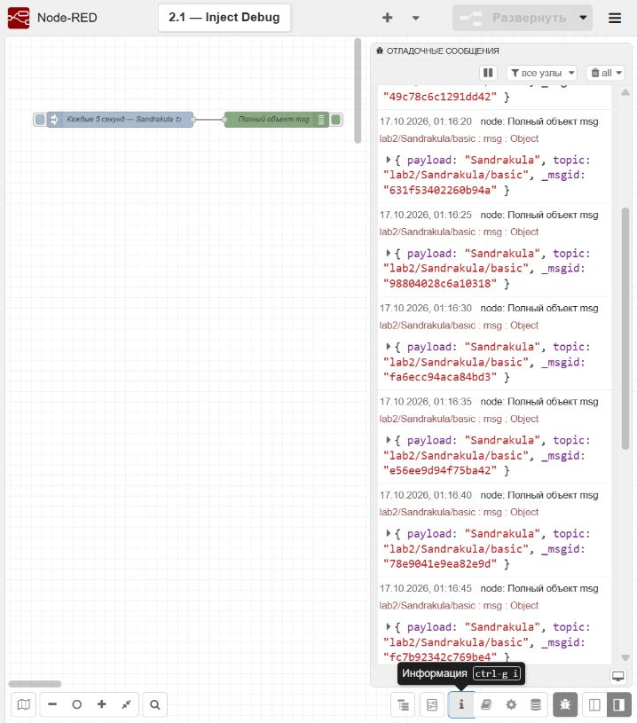

#### 2.2. Function node

**Что сделали:** Function вычисляет сумму квадратов с использованием `let`, `const`, `for`, массива, объекта и `if/else`.

**Результат:** Для числа 6 получены квадраты от 1 до 36, сумма 91 и категория «большой результат».

**Скриншот:**

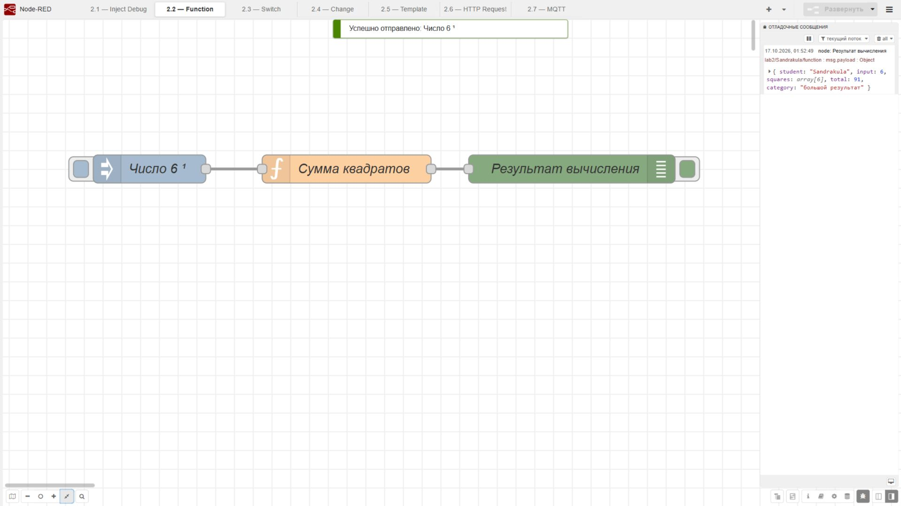

#### 2.3. Switch node

**Что сделали:** Switch проверяет `msg.payload` и направляет значения по двум выходам: результат не меньше 50 или меньше 50.

**Результат:** Значение 91 прошло по первой ветке, а 14 — по второй; оба выхода подтверждены в Debug.

**Скриншот:**

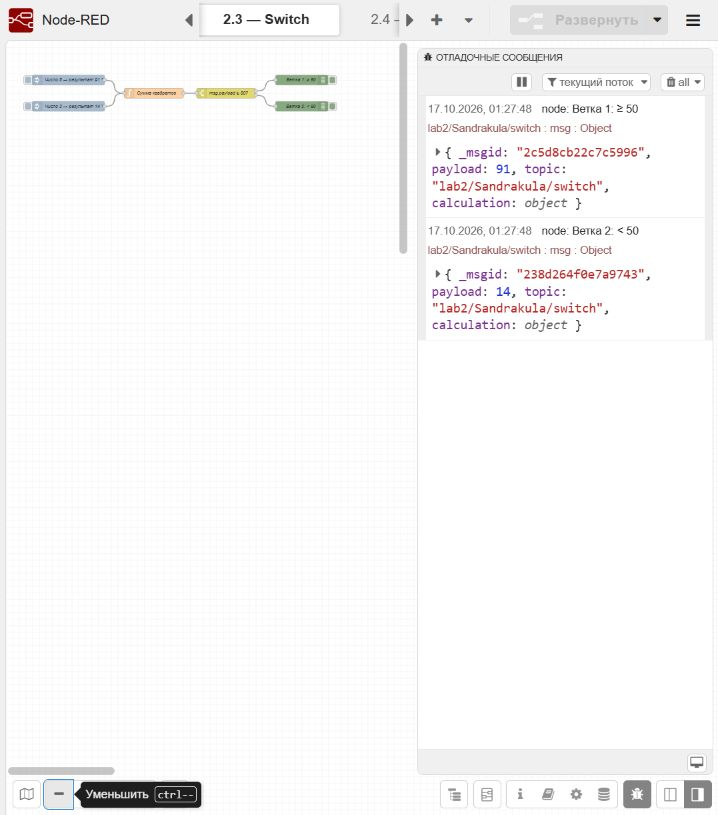

#### 2.4. Change / Set node

**Что сделали:** Change-нода задаёт новый `topic`, текстовый `payload` и текущий `timestamp` через JSONata `$millis()`.

**Результат:** В полном объекте Debug подтверждены все три изменённых поля.

**Скриншот:**

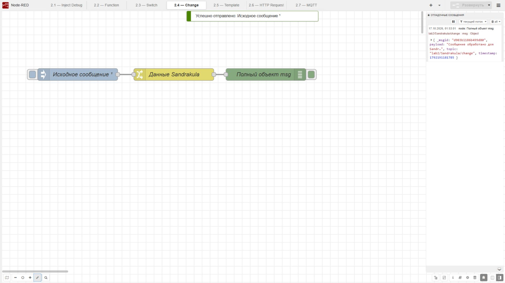

#### 2.5. Template node

**Что сделали:** Mustache-шаблон подставляет данные студента и формирует готовый JSON-объект.

**Результат:** Получен JSON с `student: Sandrakula`, предметом, лабораторной и итоговым сообщением.

**Скриншот:**

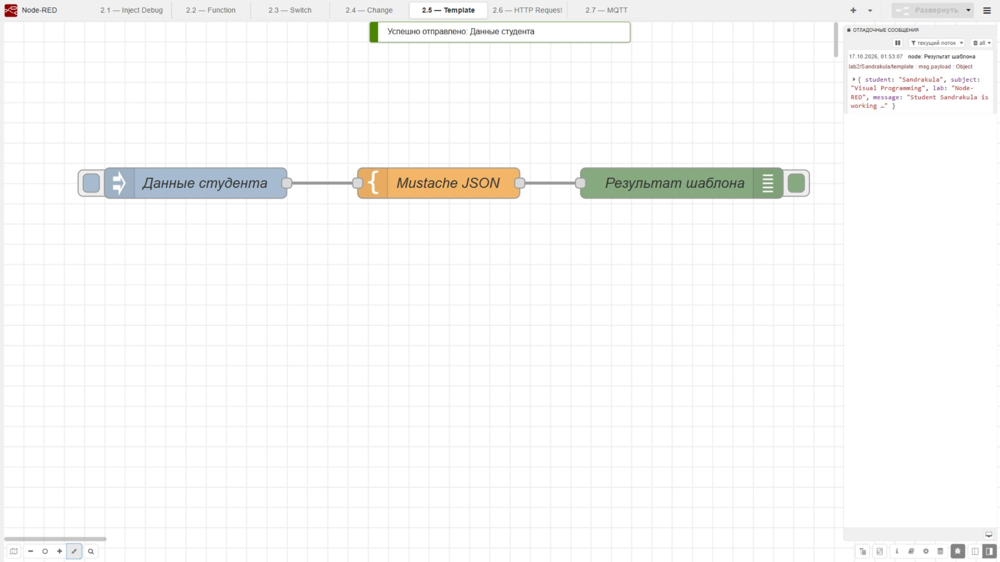

#### 2.6. HTTP Request node

**Что сделали:** Поток выполняет GET-запрос к JSONPlaceholder, а HTTP Request сразу разбирает ответ как JSON.

**Результат:** Получен статус 200 и объект todo с полями `userId`, `id`, `title` и `completed`.

**Скриншот:**

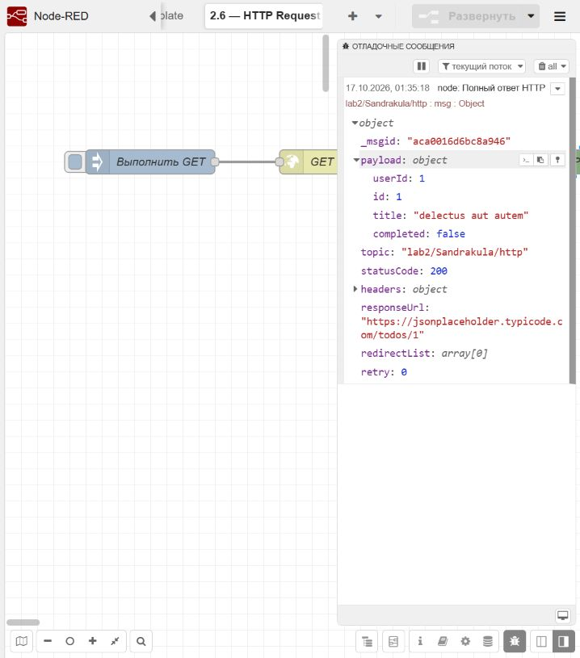

#### 2.7. MQTT с публичным брокером

**Что сделали:** MQTT Out публикует случайную температуру в топик `student/Sandrakula/lab2/temperature` через публичный брокер `broker.hivemq.com`, а MQTT In подписан на тот же топик.

**Результат:** Обе MQTT-ноды подключены, входящие числовые значения регулярно появляются в Debug.

**Скриншот:**

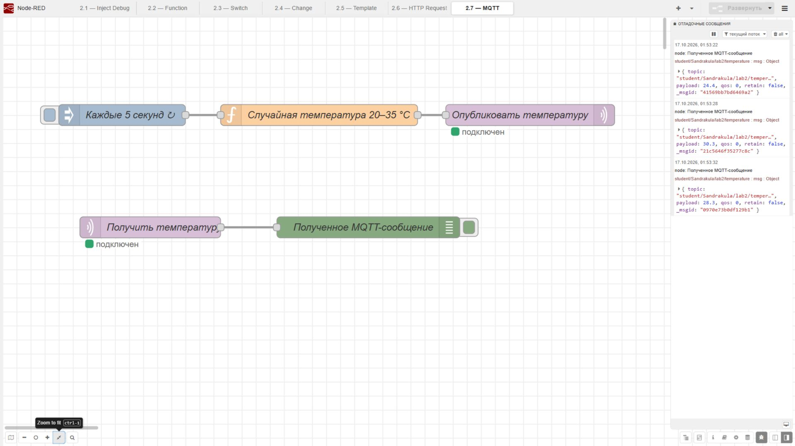

#### 2.8. GET-эндпоинты

**Что сделали:** Создали три маршрута: `/api/text`, `/api/info` и `/api/items?id=...`. Последний маршрут проверяет параметр и возвращает статусы 200, 400 или 404.

**Результат:** Реальными запросами подтверждены `200 OK`, `400 Bad Request` и `404 Not Found`; команды и полные ответы приведены в [документации API](docs/api.md).

**Скриншот:**

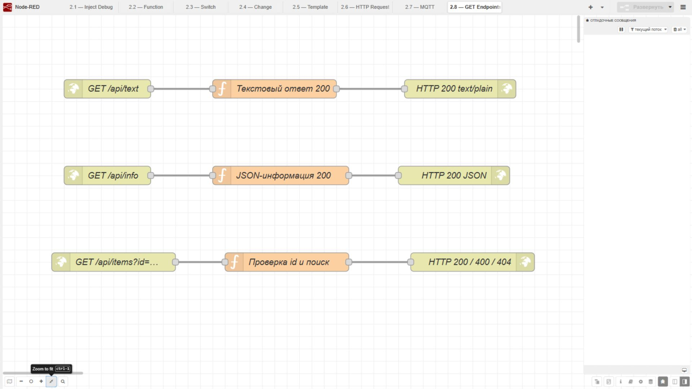

`http://localhost:1880/api/text` — 200 OK:

`http://localhost:1880/api/info` и `http://localhost:1880/api/items?id=1` — 200 OK:

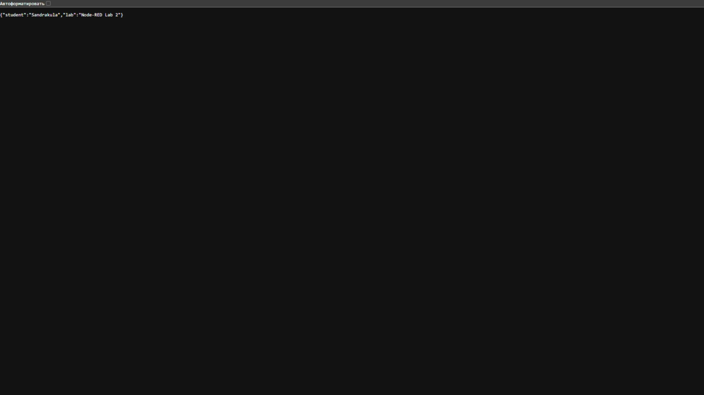 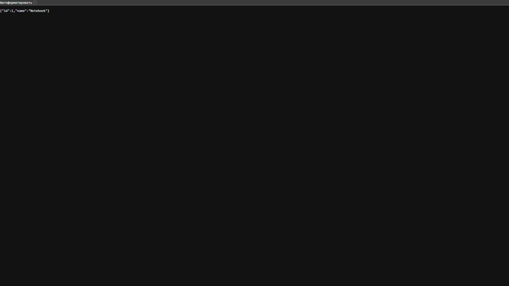

`http://localhost:1880/api/items?id=abc` — 400, `http://localhost:1880/api/items?id=999` — 404:

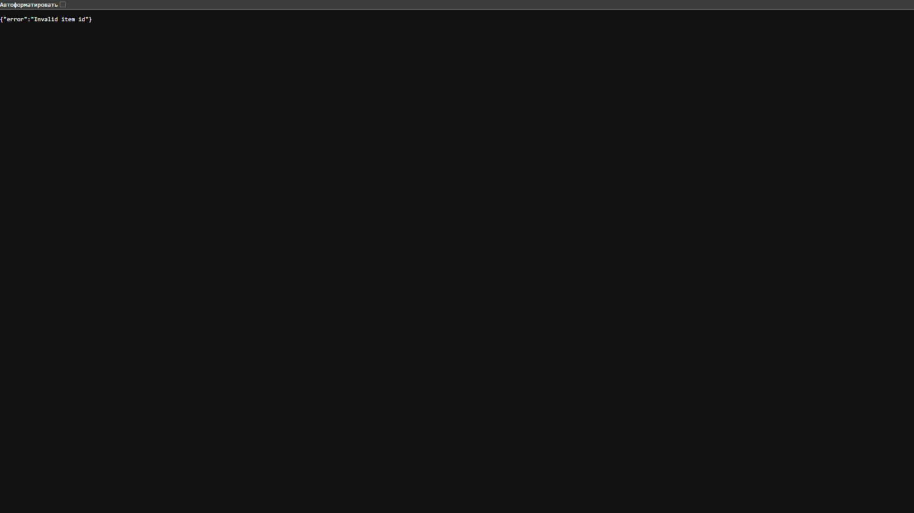 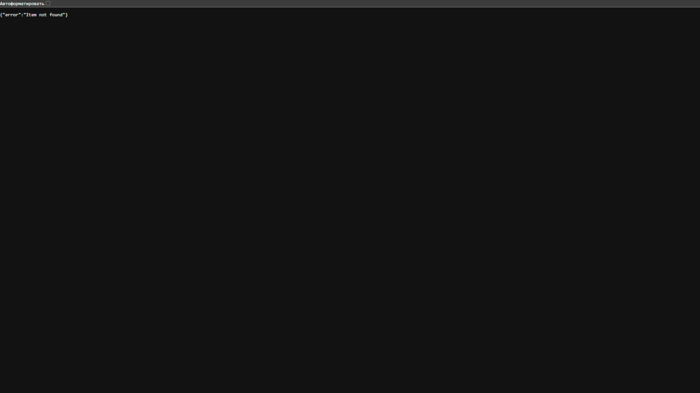

#### 2.9. Dashboard с gauge и графиком

**Что сделали:** Inject и Function генерируют температуру каждые пять секунд и передают её в Gauge и Chart.

**Результат:** Dashboard отображает текущее значение на Gauge и накапливает историю температуры на графике.

**Скриншот:**

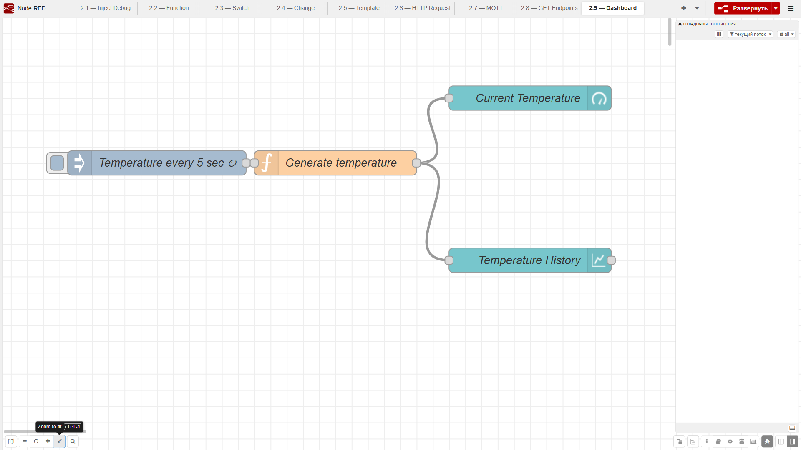

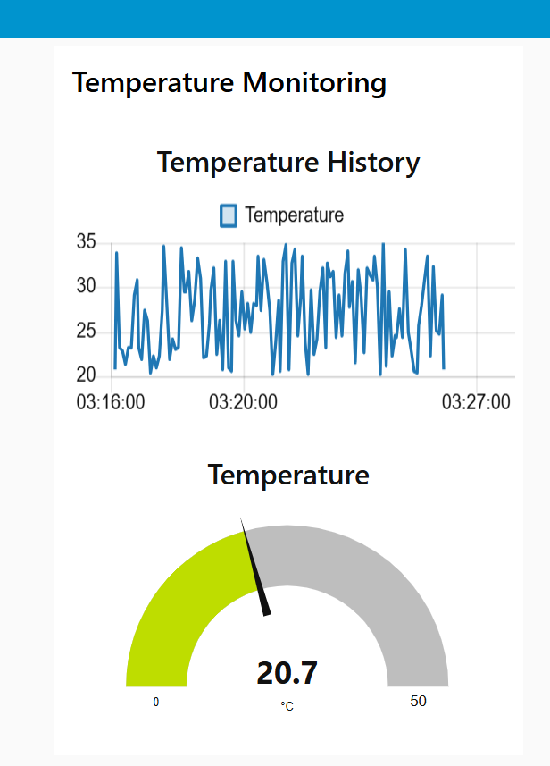

#### 2.10. Telegram-бот

**Что сделали:** Отдельные ветки обрабатывают `/start`, `/help` и обычные сообщения Echo; все Telegram-ноды используют одну конфигурацию бота.

**Результат:** Бот отвечает на обе команды и без изменений повторяет сообщения `Привет` и `Проверка 123`.

**Скриншот:**

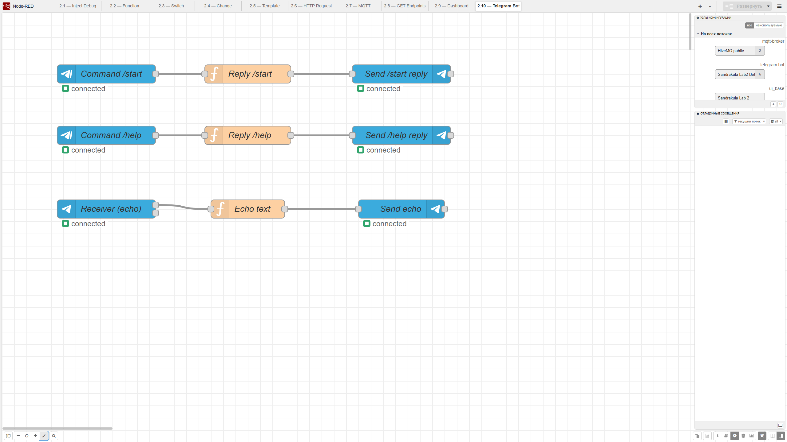

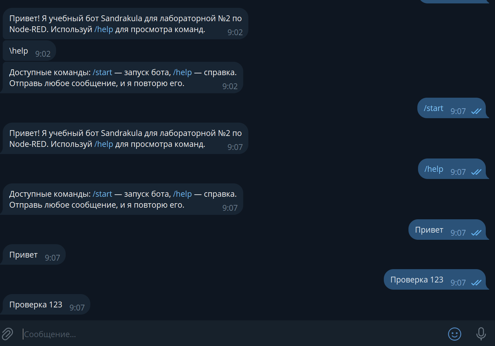

Токен Telegram не включён в экспортированные потоки, документацию или Git.

#### 2.11. Чтение и запись файла

**Что сделали:** Первая ветка добавляет JSON-строки с фамилией, временем и числом в `/data/lab2-files/sandrakula-log.txt`, вторая ветка читает файл в Debug.

**Результат:** Записаны и прочитаны три строки; после перезапуска Node-RED файл сохранился благодаря bind mount `/data`.

**Скриншот:**

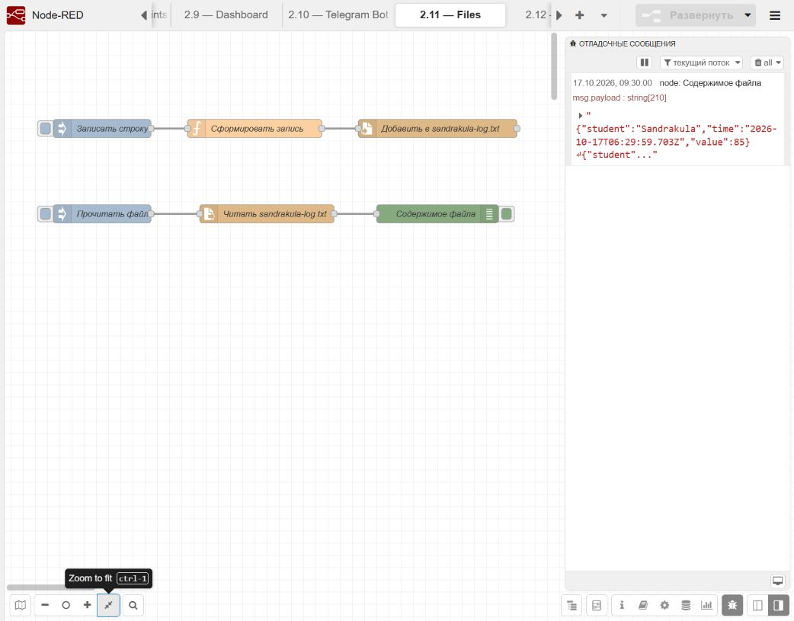

#### 2.12. Работа с контекстом

**Что сделали:** Function хранит счётчик через `flow.get()` и `flow.set()`; отдельная ветка сбрасывает его в ноль.

**Результат:** Без повторного Deploy получена последовательность значений `1 → 2 → 3 → 4`.

**Скриншот:**

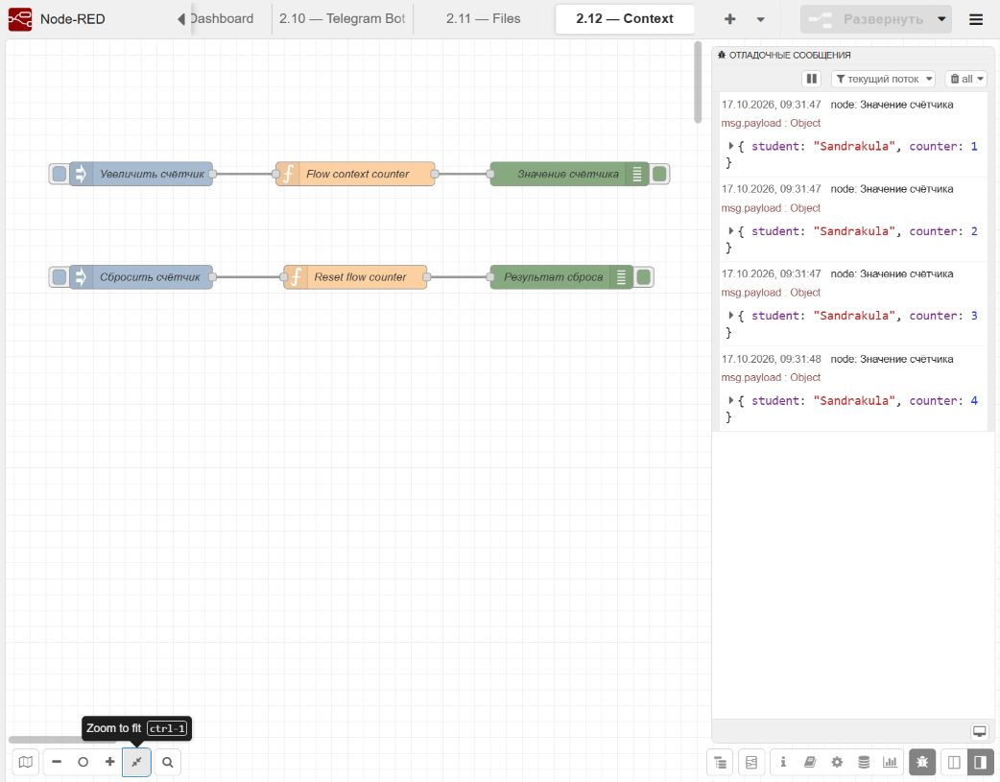

## Часть 3. Ачивки

Дополнительные ачивки в рамках данной работы не выполнялись.

## Часть 4. Вывод

В ходе работы освоен редактор Node-RED и создание потоков из связанных нод. Получены практические навыки работы с JavaScript, HTTP API, MQTT и Telegram. Также реализованы Dashboard, постоянное хранение файлов и счётчик в контексте потока. Все двенадцать обязательных заданий проверены в работающем контейнере.

## Дополнительные материалы

- [Полный отчёт](docs/report.md)
- [Документация API](docs/api.md)
- [Инструкция по демонстрации](docs/demo.md)
- [Экспортированные потоки](flows/)
