# Лабораторная работа №3. Bubble

## 1. Цель работы

Освоить Bubble как no-code платформу: создать приложение при помощи AI-генерации, вручную доработать интерфейс, спроектировать новую сущность базы данных и реализовать CRUD через workflows.

## 2. Описание приложения

«ООО НичегоНеДелаем» — публичная русскоязычная шуточная корпоративная система. В приложении есть панель управления, реестр сотрудников и раздел корпоративных отмазок. Интерфейс построен по схеме Header + Body + Footer.

## 3. Исходный AI-промпт

```text
Create a responsive web application called "ООО НичегоНеДелаем" — a humorous corporate management portal for the world's most unproductive company. The application must be PUBLIC and require NO registration or login. All visible interface text must be in Russian. DESIGN: Create a beautiful, modern corporate dashboard that looks like a serious enterprise HR system but contains funny, absurd content. Use a professional blue, white, and purple color palette, rounded cards, modern typography, icons, and subtle humor. Use the mandatory layout: HEADER + BODY + FOOTER. In the header, prominently display the exact text: "ТВП: Сандракула". MAIN SECTIONS: 1. Dashboard — "Панель управления" Show humorous company statistics: - Всего бездельников - Задач успешно проигнорировано - Часов потрачено на кофе - Уровень корпоративной лени 2. Employees — "Наши специалисты" Create an employee management system with a database and interactive CRUD operations: - Add employee (Create) - View employees (Read) - Edit employee information (Update) - Fire employee (Delete) Each employee has a name, absurd job title, department, and laziness level. Example employees: - Иван Диванов — Директор по стратегическому лежанию - Пётр Перекуров — Главный специалист по перекурам - Алексей Завтраков — Руководитель отдела "Сделаем завтра" 3. "Реестр великих отмазок" Add a visually attractive section introducing the company's collection of excuses for unfinished work. Show humorous examples: - "Docker объявил независимость" - "Задачу выполнил мысленно" - "Компьютер устал раньше меня" - "Слишком продуктивен для этой должности" For now, this section can be informational. Do not create a separate Excuse database type yet, as it will be added manually later. INTERACTIVITY: Employee management should use Bubble's built-in database and workflows wherever supported, not just decorative buttons. Add clearly visible navigation, interactive buttons, employee cards, and forms. FOOTER: Display "ООО НичегоНеДелаем © 2026" and the humorous slogan "Мы не ленивые. Мы энергоэффективные." Make the application visually polished, funny, easy to navigate, and simple to customize later using Bubble's visual editor.
```

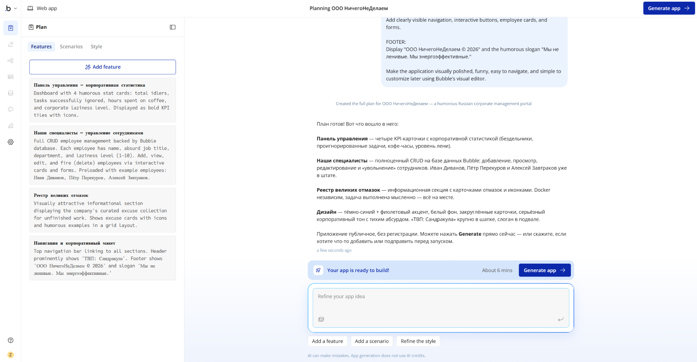

## 4. Ссылки

- Dev-версия Bubble: <https://my-app-261024-58682.bubbleapps.io/version-test>
- Репозиторий: <https://github.com/sandrakula/visual-programming-labs-Sandrakula>

## 5. Исследование Build Guides

Изучены руководства **Employee Cards** и **Laziness Level Sorting**. Первое показало рекомендуемую структуру карточек и вывод данных через repeating group. Второе описывает сортировку `Do a search for Employees` по числовому полю уровня лени. Практическая идея для приложения — сортировка сотрудников по уровню лени.

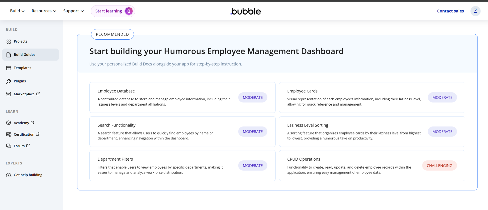

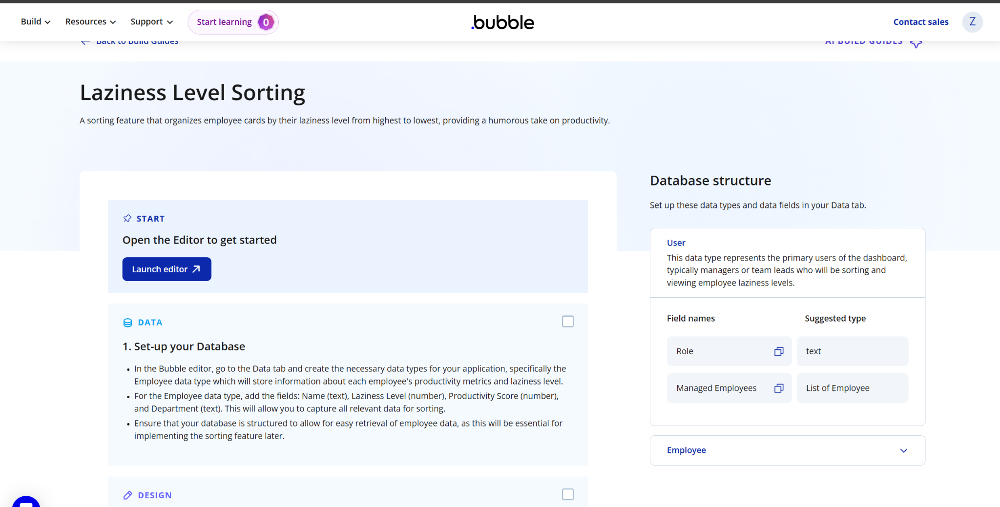

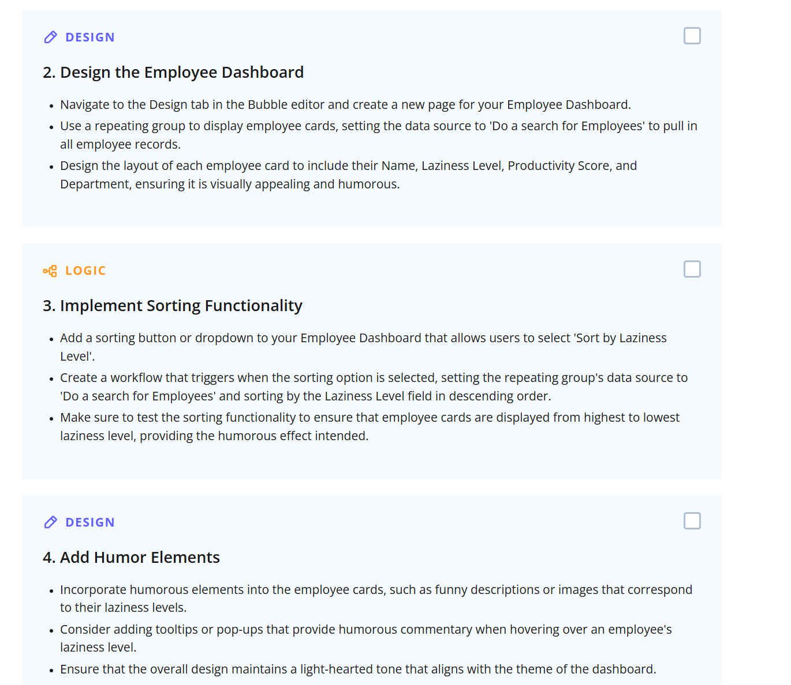

Исходное состояние страницы сотрудников:

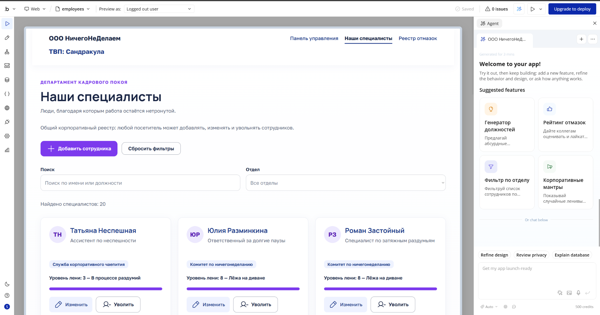

Идея из руководства реализована в приложении: на странице `employees` появился dropdown «Сортировка» с тремя режимами. Проверка в Preview подтвердила порядок `10 → 1` для «Самые ленивые» и `1 → 10` для «Самые трудолюбивые».

Фактически использованный промпт:

```text
На странице employees добавь сортировку существующего Repeating Group сотрудников по числовому полю Уровень лени, не ломая поиск, фильтр отделов и CRUD. Добавь видимый dropdown «Сортировка» с вариантами «По умолчанию», «Самые ленивые», «Самые трудолюбивые». Для «Самые ленивые» сортируй по уровню лени по убыванию (10→1), для «Самые трудолюбивые» — по возрастанию (1→10), по умолчанию сохрани текущий порядок. Используй реальные данные Сотрудник и проверь результат в Preview. Не меняй privacy rules и структуру базы.
```

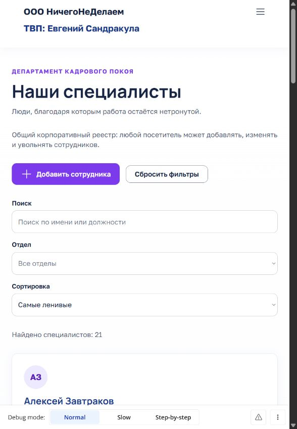

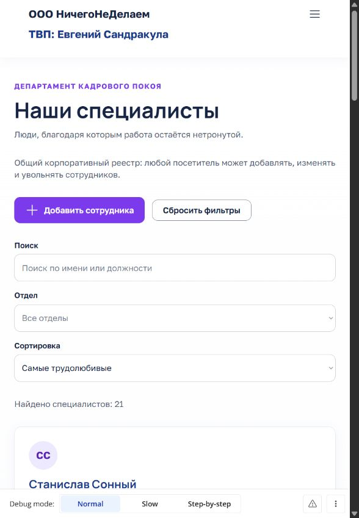

## 6. Ручная доработка UI

- Текст в общем Header изменён вручную: `ТВП: Сандракула` → `ТВП: Евгений Сандракула`.
- Создана глобальная переменная цвета `primary-color` со значением `#7C3AED`.
- Создан стиль кнопки `LazyButton`; его фон связан с `primary-color`.
- Стиль `LazyButton` применён к кнопке «Добавить сотрудника».
- Вручную отредактирован готовый reusable-компонент `Header`; готовые компоненты `Header` и `Footer` используются на страницах приложения.

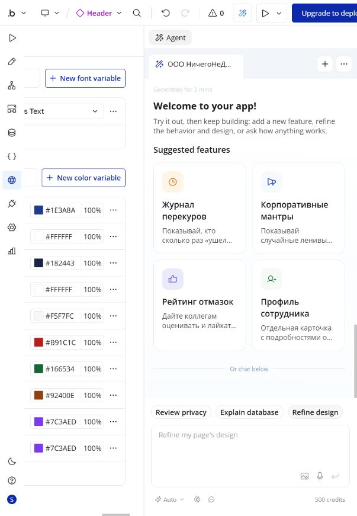

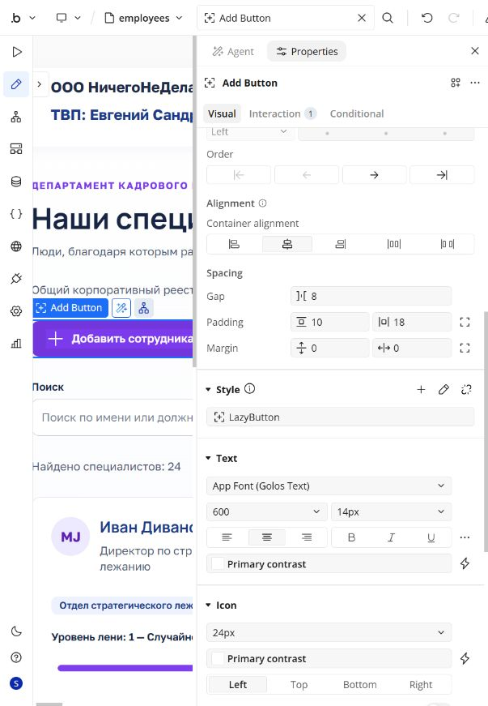

## 7. Data Type Excuse

Для предложения схемы был фактически использован следующий AI-промпт:

```text
Предложи название новой сущности для реестра корпоративных отмазок и минимум пять полей разных типов. Нужны: название, подробное описание, убедительность от 1 до 10, признак одобрения руководством и дата регистрации. Только предложи схему, ничего не создавай и не изменяй в приложении.
```

После ответа AI тип `Excuse` создан вручную с полями:

| Поле | Тип Bubble | Назначение |
|---|---|---|
| `title` | text | Название отмазки |
| `description` | text | Подробное объяснение |
| `credibility` | number | Убедительность от 1 до 10 |
| `approved` | yes/no | Одобрение руководством |
| `excuse_date` | date | Дата регистрации |

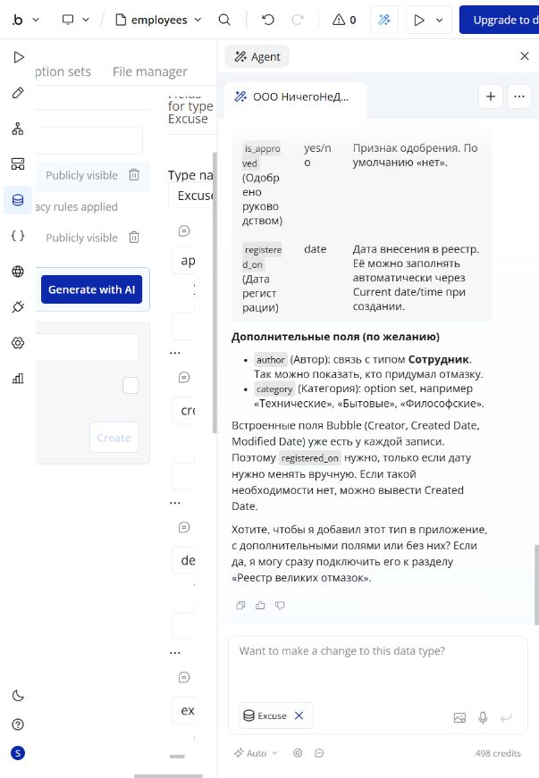

В Development database вручную добавлены три записи: «Docker объявил независимость», «Задача выполнена мысленно» и «Клавиатура ушла в отпуск».

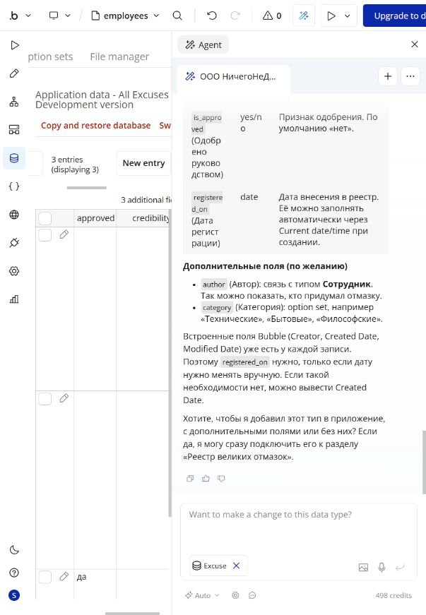

## 8. CRUD и workflows

Для разрешённой AI-доработки страницы использован промпт:

```text
Не изменяй privacy rules и не добавляй или не изменяй поля Excuse: схема уже готова. На существующей странице excuses создай только UI и отдельные workflows для реального CRUD сущности Excuse: Create (Make a new Excuse), Read (Repeating Group с Do a search for Excuses), Update (Make changes to выбранный Excuse), Delete (Delete выбранный Excuse с подтверждением). Используй поля title, description, credibility, approved, excuse_date. Сохрани русский интерфейс, Header + Body + Footer и текущую корпоративно-юмористическую стилистику. Не трогай Employee и страницу employees.
```

Реализованы отдельные workflows:

- **Create** — кнопка формы запускает `Make a new Excuse`, проверяет диапазон убедительности 1–10 и очищает поля;
- **Read** — Repeating Group получает данные через `Do a search for Excuses` и показывает реальные записи;
- **Update** — выбранная запись загружается в форму, а сохранение выполняет `Make changes to Excuse`;
- **Delete** — отдельный workflow открывает окно подтверждения, отмена закрывает его, подтверждение выполняет `Delete Excuse`.

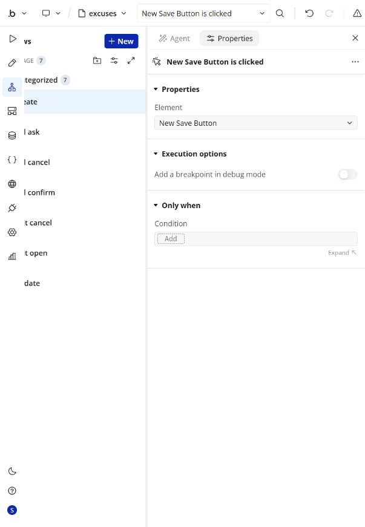

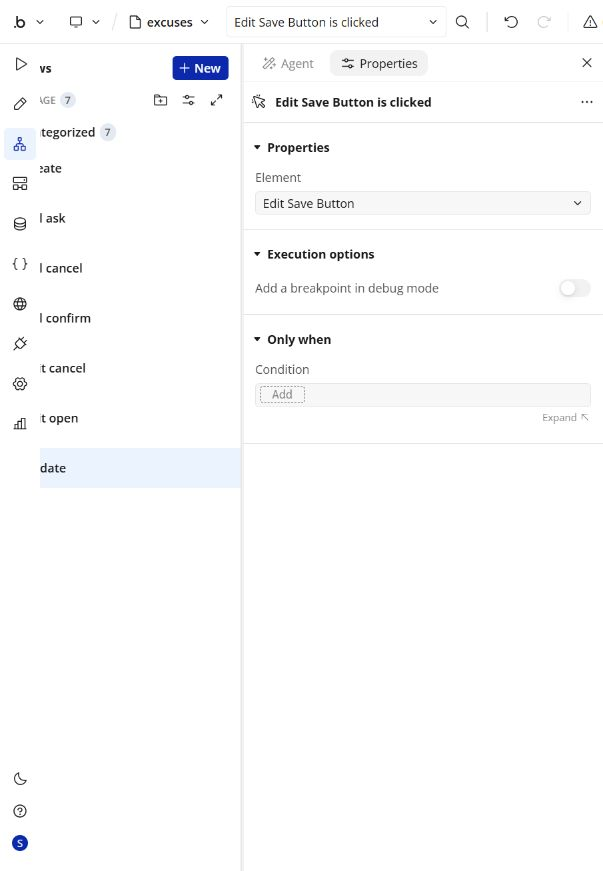

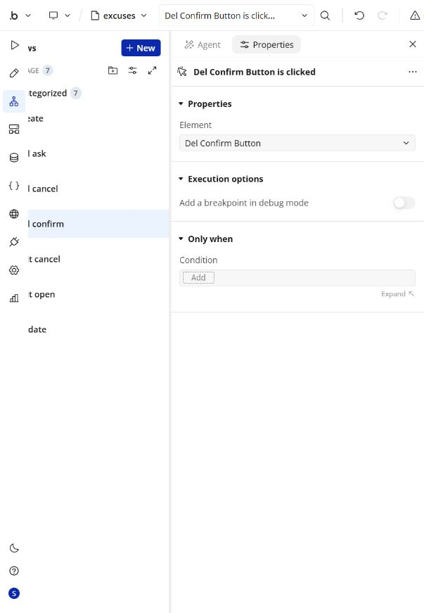

В Preview список успешно прочитан. Создана тестовая запись «Совещание отменило само себя», затем она изменена на «Совещание отменило само себя — проверено», а её убедительность увеличена до 10. Финальное нажатие удаления не выполнялось, чтобы не уничтожать доказательную запись без отдельного подтверждения пользователя; сам workflow и диалог подтверждения настроены.

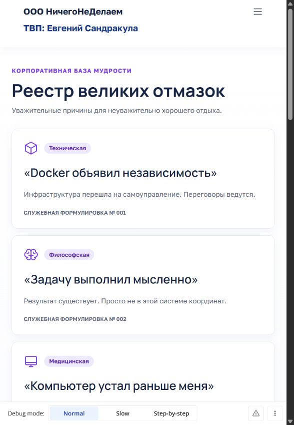

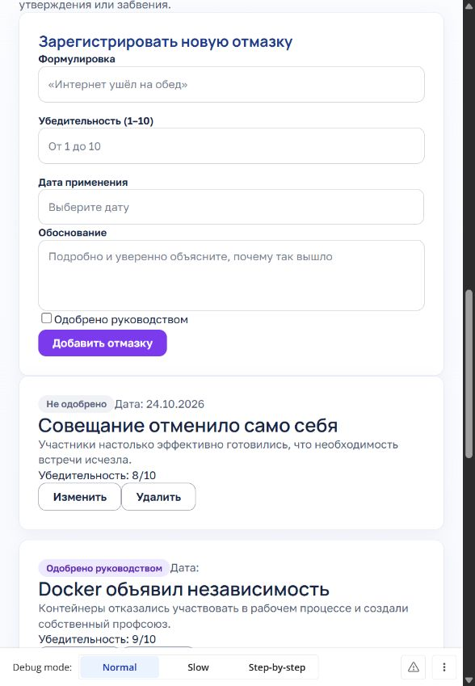

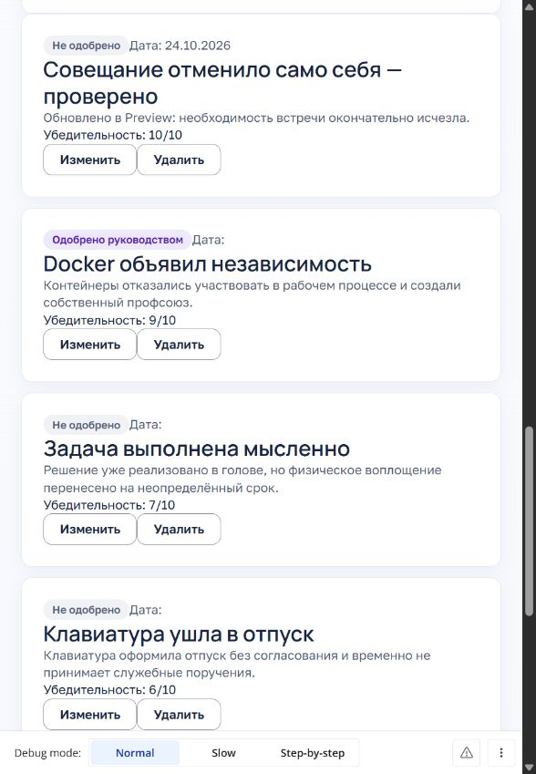

## 9. Проверка приложения

CRUD сотрудников ранее проверен операцией Create: добавлен «Абубачир Трахов — Ассистент двери», число записей увеличилось с 20 до 21.

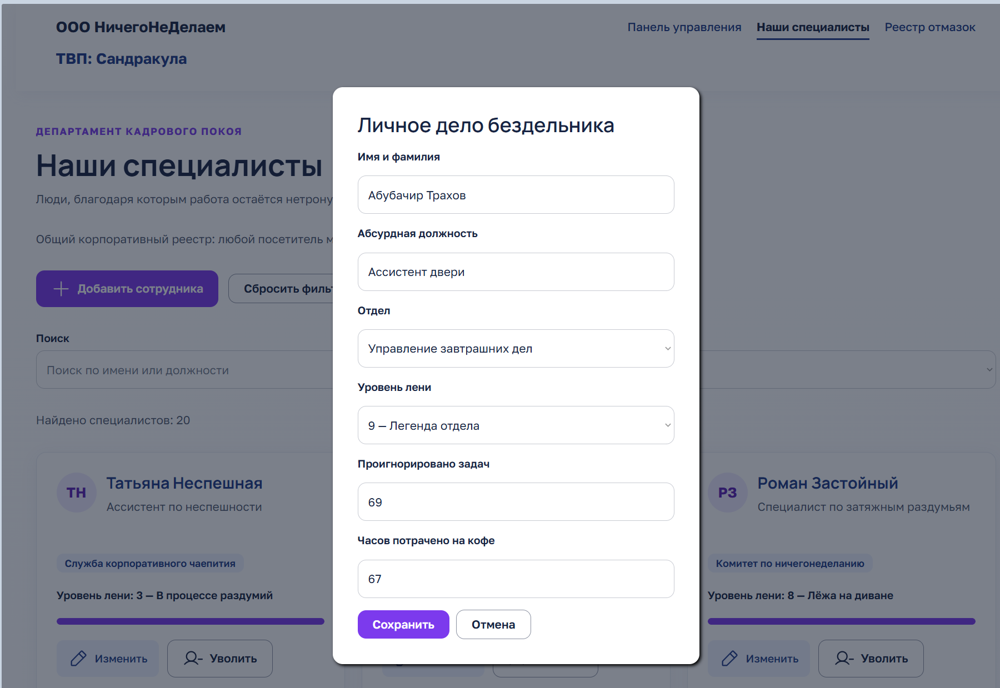

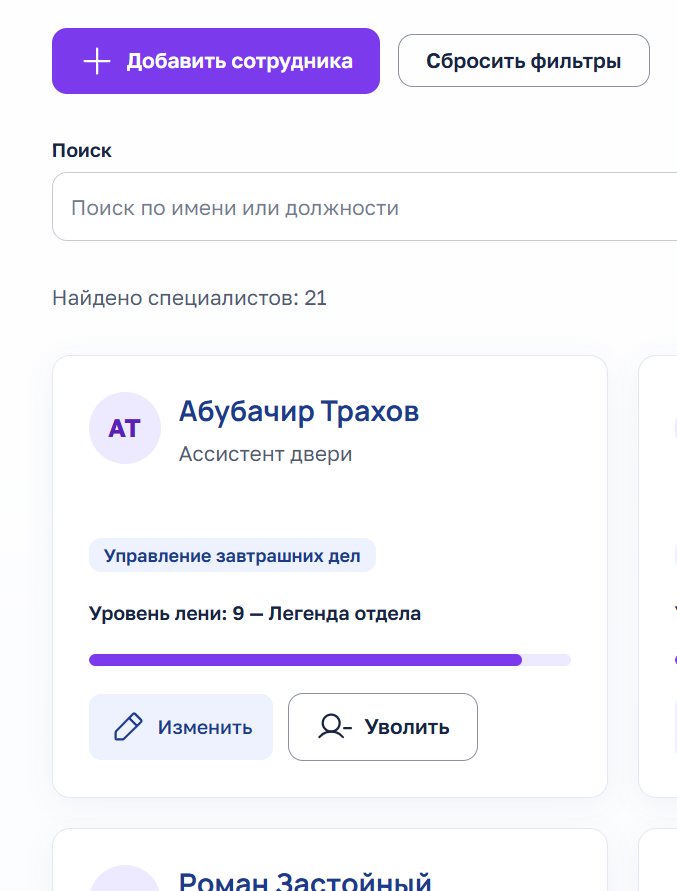

## 10. Выводы

В ходе работы освоены AI-генерация Bubble, Build Guides, ручное редактирование reusable Header, Global Variables, собственные стили, Data Types, App Data и построение отдельных CRUD-workflows. Реальные данные, Create, Read, Update и сортировка в обе стороны проверены в Preview; Delete реализован с обязательным подтверждением. Требования по API Connector и Plugins в этой работе не применялись.
