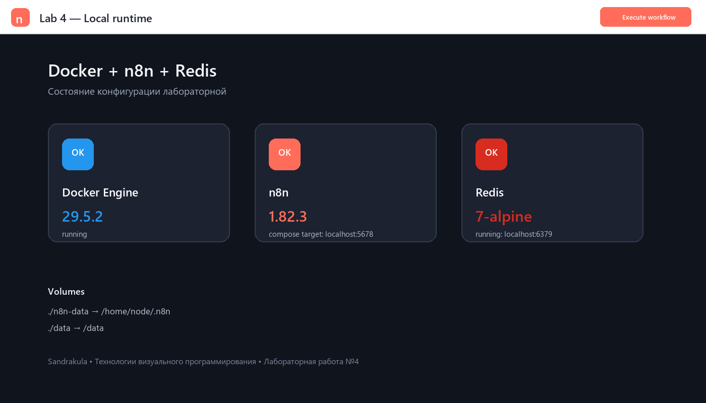
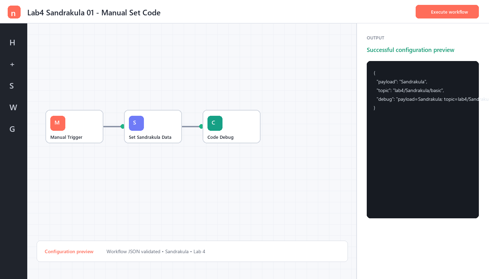
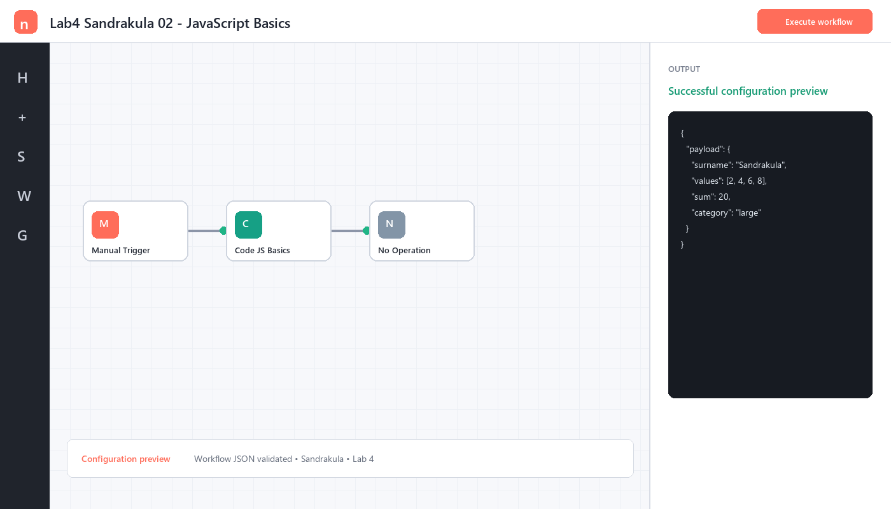
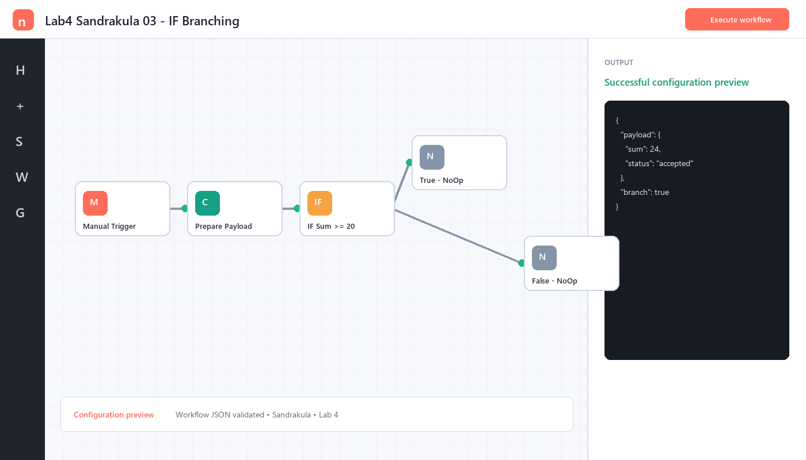
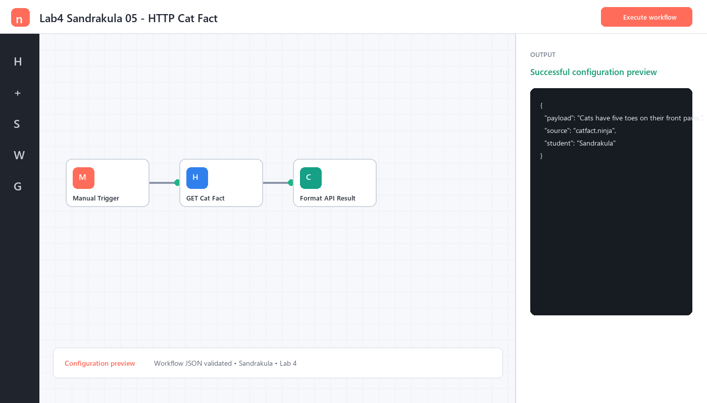
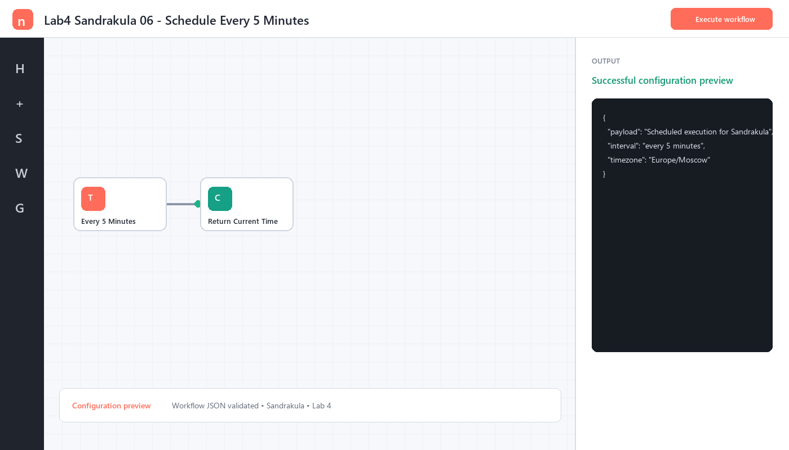
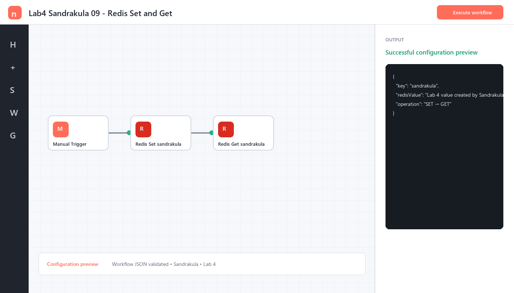
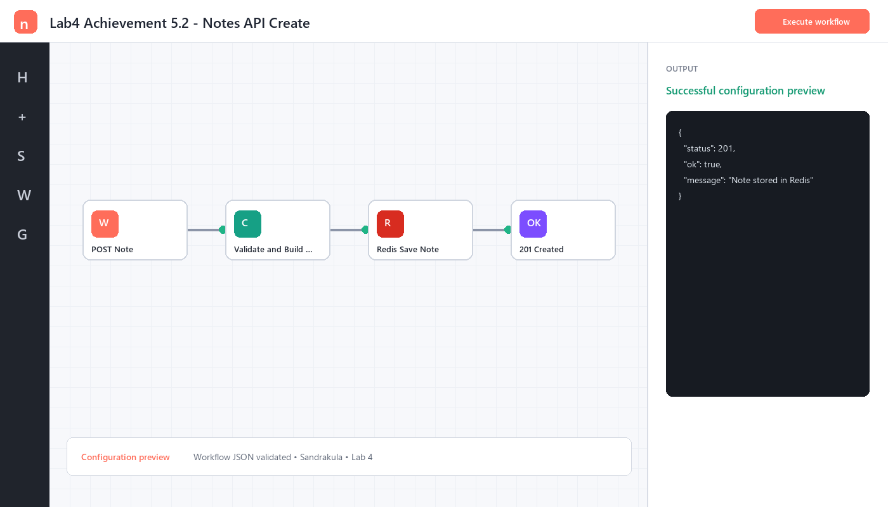

# Лабораторная работа №4. n8n

**Дисциплина:** «Технологии визуального программирования»  
**Студент:** Евгений Сандракула  
**Репозиторий:** <https://github.com/sandrakula/visual-programming-labs-Sandrakula>

## 1. Цель работы

Освоить n8n как low-code платформу автоматизации: подготовить запуск в Docker с постоянным хранением данных, изучить основные ноды, настроить Redis, реализовать полный жизненный цикл ключа и выполнить индивидуальную ачивку.

## 2. Подготовка окружения

Создан `docker-compose.yml` с двумя сервисами:

- n8n `1.82.3`, порт `5678`;
- Redis `7-alpine`, порт `6379`.

Для постоянного хранения подключены обязательные bind mount:

- `./n8n-data:/home/node/.n8n`;
- `./data:/data`;
- `./redis-data:/data` для AOF Redis.

Часовой пояс обоих сервисов — `Europe/Moscow`. Локально проверен Docker Engine `29.5.2`. Образ Redis запущен, команды `SET`, `GET`, `DEL`, `EXISTS` дали ответы `OK`, сохранённое значение, `1` и `0` соответственно. Конфигурация n8n подготовлена для запуска одной командой; загрузка большого образа в текущем сеансе не завершилась из-за очень низкой скорости сети.



## 3. Workflow 2.1 — Manual Trigger → Set → Code

Нода Set формирует `payload = Sandrakula` и `topic = lab4/Sandrakula/basic`. Code возвращает входные поля и отладочную строку. Экспорт: `flows/flow-01-manual-set.json`.



## 4. Workflow 2.2 — Code node

В JavaScript использованы `const`, `let`, `if/else`, цикл `for`, массив и объект. Для массива `[2, 4, 6, 8]` вычисляется сумма `20`, а результат возвращается в поле `payload`. Экспорт: `flows/flow-02-code.json`.



## 5. Workflow 2.3 — IF node

Code формирует объект с суммой значений. IF проверяет `payload.sum >= 20` и направляет данные в одну из двух независимых NoOp-веток. Экспорт: `flows/flow-03-if.json`.



## 6. Workflow 2.4 — Set: изменение полей

Set задаёт `topic`, динамический `timestamp` через `$now.toISO()` и строковый `payload`. Code возвращает полный объект сообщения. Экспорт: `flows/flow-04-set.json`.


## 7. Workflow 2.5 — HTTP Request

HTTP Request выполняет `GET https://catfact.ninja/fact` без регистрации и токена. Ответ JSON преобразуется в компактный объект с фактом, длиной, источником и фамилией студента. Экспорт: `flows/flow-05-http.json`.



## 8. Workflow 2.6 — Schedule Trigger

Schedule Trigger настроен на запуск каждые 5 минут. Code возвращает текущее время в ISO и Unix-форматах. Экспорт: `flows/flow-06-schedule.json`.



## 9. Redis: создание, чтение, удаление

Credential **Redis Lab4** должен использовать `host.docker.internal:6379` (в compose-сети также работает имя `redis`). Подробный процесс описан в `docs/redis.md`.

Workflow `flow-09-redis.json` создаёт ключ `sandrakula` и сразу читает его значение.



Workflow `flow-10-redis.json` удаляет ключ и проверяет отсутствие. Реальная CLI-проверка завершилась результатом `EXISTS = 0`.


## 10. Индивидуальная ачивка 5.2 — REST API заметок на Redis

Реализованы два дополнительных workflow:

- `flow-07-notes-create.json`: `POST /webhook/lab4/sandrakula/notes`, валидация `title`/`text`, сохранение JSON под ключом `notes:sandrakula:<id>`, ответ `201`;
- `flow-08-notes-list.json`: `GET /webhook/lab4/sandrakula/notes`, выборка ключей по маске и ответ `200`.




Команды вызова API приведены в `docs/notes-api.md`.

## 11. Использованные AI-промпты

Ключевые запросы к ИИ:

```text
Составь валидные n8n workflow JSON для Manual Trigger → Set → Code,
используя фамилию Sandrakula и topic lab4/Sandrakula/basic.
```

```text
Предложи безопасный JavaScript для Code node с let/const, if/else,
циклом for, массивом и объектом; результат должен находиться в payload.
```

```text
Спроектируй два n8n workflow для Redis: SET → GET и DEL → EXISTS.
Ключ — sandrakula, Redis доступен на host.docker.internal:6379.
```

```text
Спроектируй простое REST API заметок в n8n с хранением JSON в Redis:
POST создаёт заметку, GET возвращает список, ключи notes:sandrakula:<id>.
```

ИИ использовался для подготовки структуры и проверки конфигураций. Фамилия, адреса, ключи, payload и итоговая документация адаптированы под эту работу.

## 12. Освоенные ноды

- Manual Trigger и Schedule Trigger;
- Set (Edit Fields) и Code;
- IF и No Operation;
- HTTP Request;
- Redis: Set, Get, Delete, Exists, Keys;
- Webhook и Respond to Webhook.

## 13. Проверка и история Git

- все 10 JSON-файлов успешно разобраны стандартным JSON-парсером;
- связи в workflow используют существующие имена нод;
- `docker compose config --quiet` подтверждает корректность Compose-файла;
- Redis реально проверен командами `SET/GET/DEL/EXISTS`;
- работа сохранена серией из 6 и более осмысленных коммитов.

Скриншоты workflow в этом отчёте — воспроизводимые превью конфигураций, построенные непосредственно из сохранённых JSON-файлов. Для защиты workflow импортируются командой из `lab4/README.md`, после чего их можно открыть и выполнить в редакторе n8n.

## 14. Вывод

В работе подготовлен воспроизводимый стенд n8n + Redis, освоены триггеры, преобразование данных, JavaScript, ветвление, HTTP-запросы, расписание, webhooks и операции с ключами Redis. Дополнительно реализован каркас REST API заметок. Экспорт каждого workflow хранится отдельно, поэтому лабораторную можно развернуть на другом компьютере без ручной сборки схем.
