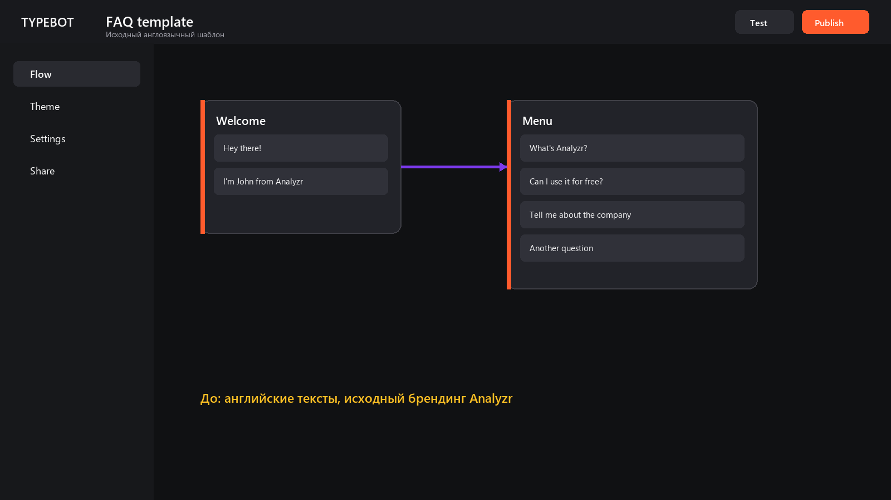
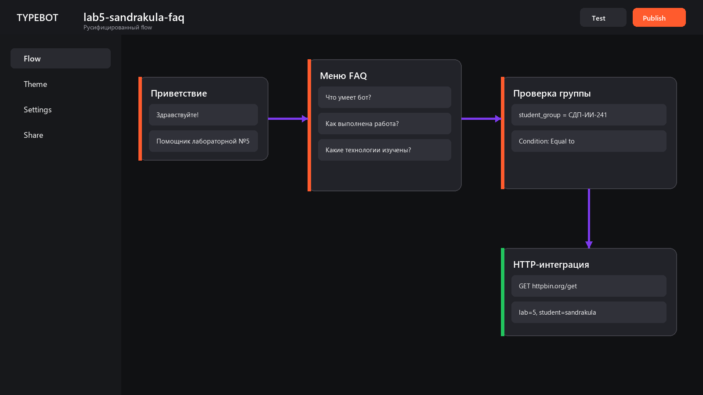
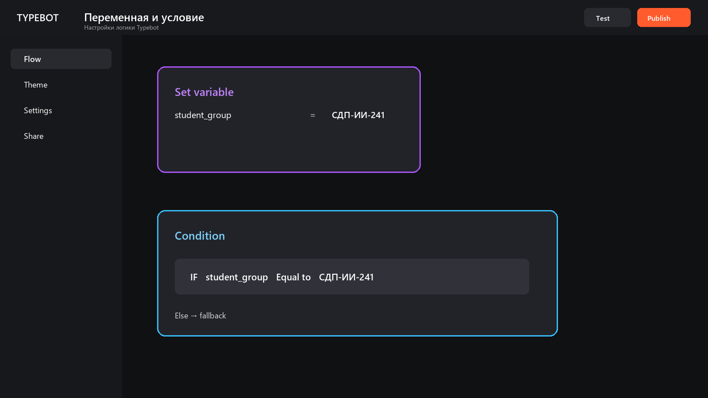
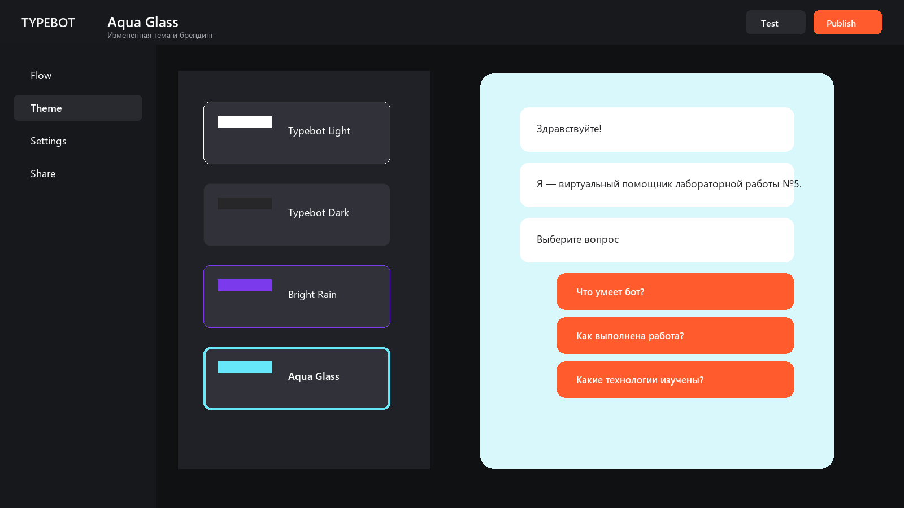
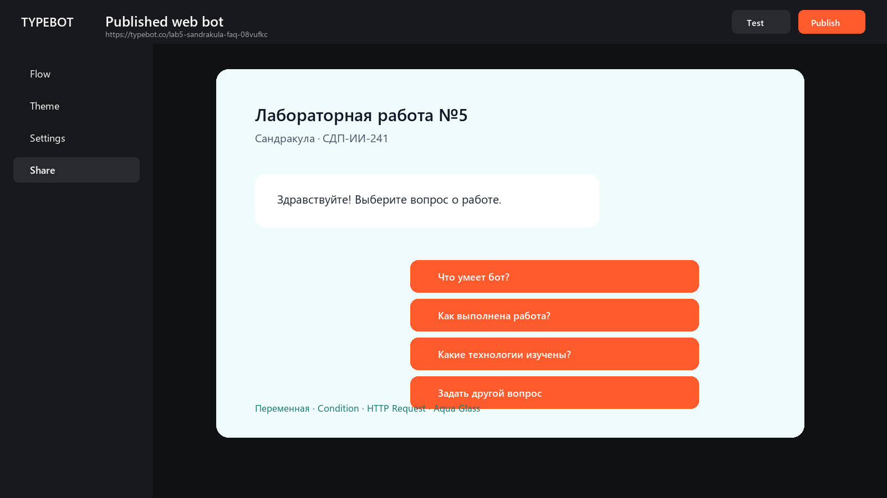

# Лабораторная работа №5. Чат-боты

**Дисциплина:** «Технологии визуального программирования»  
**Студент:** Евгений Сандракула  
**Группа:** СДП-ИИ-241  
**Трек:** C — Typebot  
**Бот:** `lab5-sandrakula-faq`  
**Ссылка:** <https://typebot.co/lab5-sandrakula-faq-08vufkc>

## 1. Цель работы

Освоить Typebot как no-code платформу для создания чат-ботов: изменить готовый
шаблон, настроить русскоязычный диалог, переменные, условное ветвление,
интеграцию и оформление, после чего подготовить публикацию и экспорт сценария.

## 2. Выбранный шаблон

В галерее Typebot выбран шаблон **FAQ**. Исходная версия была англоязычной и
посвящалась сервису Analyzr.



## 3. Русификация и изменение сценария

Бот переименован в `lab5-sandrakula-faq`. На русский язык переведены
приветствие, описание, пункты меню, ответы, кнопки, плейсхолдер поля свободного
вопроса и подпись кнопки отправки.

Меню содержит четыре действия:

- «Что умеет бот?»;
- «Как выполнена работа?»;
- «Какие технологии изучены?»;
- «Задать другой вопрос».



## 4. Новые блоки и логика

В сценарий добавлены три новых элемента:

1. **Set variable** — переменная `student_group` получает значение
   `СДП-ИИ-241`.
2. **Condition** — проверяется условие
   `student_group Equal to СДП-ИИ-241`; предусмотрена ветка `Else`.
3. **HTTP Request** — выполняется безопасный тестовый GET-запрос:
   `https://httpbin.org/get?lab=5&student=sandrakula`.

HTTP-запрос не содержит паролей, токенов или персональных контактов.



## 5. Тема и брендинг

Вместо исходного оформления применена тема **Aqua Glass**. Она меняет фон,
контраст карточек диалога и оформление кнопок. Бесплатный тариф сохраняет
подпись Made with Typebot.



## 6. Публикация и результат

Для бота подготовлен публичный идентификатор
`lab5-sandrakula-faq-08vufkc`. После публикации web-версия доступна по ссылке,
указанной в начале отчёта. Экспорт сценария сохранён в
`exports/lab5-sandrakula-faq.json`.



## 7. Использованные AI-промпты

Ключевые запросы к ИИ:

```text
Предложи короткий русскоязычный сценарий FAQ-бота для лабораторной работы №5,
используя фамилию Сандракула и группу СДП-ИИ-241.
```

```text
Подбери названия четырёх кнопок FAQ так, чтобы студент мог объяснить назначение
бота, ход работы, освоенные технологии и задать свободный вопрос.
```

```text
Предложи демонстрационную переменную и условие Typebot без персональных данных
и внешних секретов.
```

```text
Подбери безопасный GET endpoint для демонстрации HTTP Request в учебном боте.
```

```text
Составь структуру отчёта Markdown со ссылкой, экспортом, скриншотами и выводами.
```

## 8. Освоенные элементы

- шаблоны и визуальный редактор Typebot;
- Text и Buttons;
- пользовательский Text input;
- Set variable;
- Condition и fallback-ветка `Else`;
- HTTP Request;
- переходы между группами;
- тема и web-публикация;
- экспорт сценария в JSON.

## 9. Ограничения бесплатного тарифа

- отображается брендинг Made with Typebot;
- часть интеграций и расширенных настроек требует платного тарифа;
- действуют ограничения на количество чатов и использование рабочих
  пространств;
- собственный домен недоступен без подходящего платного плана;
- точные лимиты могут изменяться платформой.

## 10. Вывод

Готовый шаблон ускоряет разработку, но требует внимательной адаптации всех
видимых текстов и переходов. Переменные и Condition позволяют управлять
ветвлением без кода, а HTTP Request связывает диалог с внешним API. Typebot
удобен для быстрой web-публикации, однако на бесплатном тарифе остаются
брендинг и функциональные ограничения.
